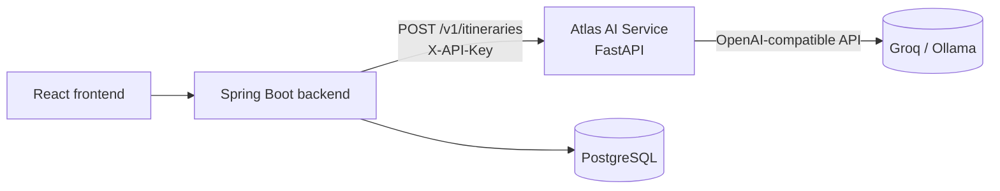
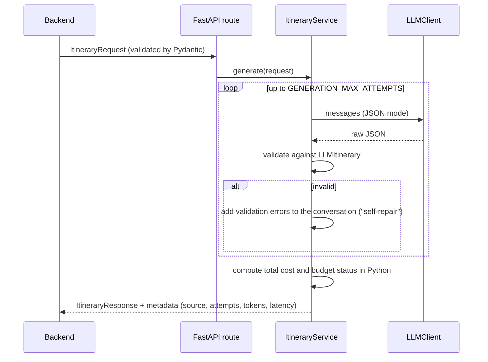

# 🤖 Atlas AI Service


The AI microservice of **Atlas**, a travel planning platform. It turns a trip request
(destination, days, budget, interests) into a **validated, structured itinerary** using an LLM.

The Spring Boot backend owns users, data and security; this service owns everything about AI:
prompts, model calls, output validation and cost calculation.



## How a request is processed



## Design decisions

| Decision | Why |
|---|---|
| **One Pydantic model as the output contract** (`LLMItinerary`) | Its JSON Schema goes into the prompt, and the same model validates the answer, so prompt and parser cannot drift apart. |
| **JSON mode + Pydantic validation + self-repair** | JSON mode guarantees valid syntax. Pydantic checks the structure (times `HH:MM`, costs ≥ 0, days 1..N). If validation fails, the errors are sent back to the model so it can fix its answer. No regex parsing. |
| **The LLM proposes, Python calculates** | Costs are numbers (`cost_eur`), not strings like `"€20-40"`. The total and `budget_status` are computed in code, because LLMs are unreliable at arithmetic. |
| **`LLMClient` Protocol + dependency injection** | Business logic depends on an interface. Tests inject a `FakeLLM` (no network, no tokens spent). Groq, Ollama or OpenAI can be swapped through configuration, because they all expose an OpenAI-compatible API. |
| **Two retry levels** | The transport (timeouts, 429, 5xx) is retried with backoff by the SDK. Invalid output is retried by the service. |
| **Explicit fallback** | If the LLM fails, a template itinerary is returned with `metadata.source = "fallback"`, so the caller is never misled. It can be disabled (`ENABLE_FALLBACK=false` → HTTP 502). |
| **User input sent as data** | Trip fields are serialized as JSON in the user message, never concatenated into the instructions, and their length is limited (basic prompt-injection hygiene). |
| **Observability** | Every response reports model, prompt version, attempts, token usage and latency. These are also logged. |
| **Streaming (SSE)** | `/stream` sends each day as soon as the model has closed its JSON object (a small state machine finds completed days in the partial output). Each day is validated before it is sent; the final `result` event is authoritative. |
| **Grounding** | `known_activities` (real activities from Amadeus, sent by the backend) are passed to the model, which uses their exact names and prices. This reduces invented places and prices. |
| **Partial regeneration** | `/regenerate-day` rewrites one day only, following user feedback, with a target cost computed in Python from the remaining budget. |
| **Cache** | Identical requests reuse the previous answer (LRU + TTL). The key includes model and prompt version, so a new prompt invalidates old answers. Fallbacks are never cached. In-memory behind a Protocol: a Redis version is a drop-in replacement. |
| **Structured outputs** | `LLM_RESPONSE_FORMAT=json_schema` makes the provider constrain generation to the schema, on models that support it. Validation and repair stay as a safety net. |

## Project structure

```
app/
├── main.py                  # app factory (create_app) + lifespan (shared LLM client)
├── core/
│   ├── config.py            # typed settings from env vars (pydantic-settings)
│   └── logging.py
├── api/
│   ├── deps.py              # dependency injection + API key auth
│   ├── errors.py            # domain exceptions → HTTP responses
│   └── routes/              # thin HTTP layer: health, itineraries
├── schemas/itinerary.py     # request / LLM output / response models
├── services/
│   ├── itinerary_service.py # use case: prompt → LLM → validate → repair
│   ├── budget.py            # deterministic cost calculations
│   ├── cache.py             # LRU/TTL response cache
│   ├── streaming.py         # finds completed days in a partial JSON stream
│   └── fallback.py
├── llm/
│   ├── base.py              # LLMClient Protocol, LLMResult, LLMError
│   └── openai_compatible.py # Groq / Ollama / OpenAI implementation
└── prompts/itinerary.py     # versioned prompts, separate from code
tests/                       # unit + API tests with a fake LLM
scripts/evaluate.py          # evaluation of the prompt against the real model
```

Dependencies flow in one direction: `api → services → llm / prompts / schemas`.
Nothing in `services` knows about HTTP or about a specific LLM vendor.

## Getting started

Requirements: Python 3.12+ and [uv](https://docs.astral.sh/uv/).

```bash
cp .env.example .env        # add your Groq key, or point LLM_BASE_URL to Ollama
uv sync
uv run uvicorn app.main:app --reload --port 8000
```

Interactive docs: http://localhost:8000/docs

With Docker: `docker compose up --build`.

**Free local mode with Ollama:** `ollama pull mistral:7b`, then set
`LLM_BASE_URL=http://localhost:11434/v1` and `LLM_MODEL=mistral:7b`.
With Docker, run `docker compose --profile ollama up --build` and use
`LLM_BASE_URL=http://ollama:11434/v1` (inside a container, `localhost` is the container).

## API

`POST /v1/itineraries` (header `X-API-Key` when `SERVICE_API_KEY` is set)

```json
{ "destination": "Rome, Italy", "days": 2, "budget_eur": 400, "interests": ["history", "food"] }
```

Response (shortened):

```json
{
  "destination": "Rome, Italy",
  "total_days": 2,
  "budget_eur": 400.0,
  "nights": 1,
  "total_estimated_cost_eur": 312.0,
  "budget_status": "within_budget",
  "days": [
    {
      "day": 1,
      "morning":   { "activity": "Colosseum and Roman Forum", "time": "09:00", "cost_eur": 18 },
      "afternoon": { "activity": "Pantheon and Piazza Navona", "time": "14:00", "cost_eur": 0 },
      "evening":   { "activity": "Dinner in Trastevere", "time": "20:00", "cost_eur": 35 }
    }
  ],
  "accommodation": { "name": "…", "type": "B&B", "details": "…", "cost_per_night_eur": 110 },
  "tips": ["Book the Colosseum online to skip the queue"],
  "metadata": {
    "source": "llm", "model": "openai/gpt-oss-20b", "prompt_version": "itinerary-v2",
    "attempts": 1, "latency_ms": 1840,
    "usage": { "prompt_tokens": 1210, "completion_tokens": 690, "total_tokens": 1900 }
  }
}
```

| Status | Meaning |
|---|---|
| 200 | Itinerary generated (check `metadata.source`) |
| 401 | Missing or wrong `X-API-Key` |
| 422 | Invalid request (e.g. `days` outside 1–14) |
| 502 | The LLM failed and fallback is disabled |

### Streaming

`POST /v1/itineraries/stream` takes the same body and answers with Server-Sent Events:

```
event: day
data: {"day": 1, "morning": {...}, "afternoon": {...}, "evening": {...}}

event: day
data: {"day": 2, ...}

event: result
data: { ...full ItineraryResponse... }
```

`status` events report progress (for example while an invalid answer is repaired) and an
`error` event is sent if generation fails with fallback disabled.

### Regenerate one day

`POST /v1/itineraries/regenerate-day`

```json
{
  "trip": { "destination": "Rome, Italy", "days": 2, "budget_eur": 400 },
  "plan": { "days": [ ... ], "accommodation": { ... }, "tips": [ ... ] },
  "day": 2,
  "feedback": "fewer museums, more food"
}
```

Returns the full `ItineraryResponse` with the new day and recomputed totals.

### Grounding with real activities

Add `known_activities` to the generation request:

```json
"known_activities": [{ "name": "Colosseum Underground guided tour", "price_eur": 65 }]
```

`GET /health` is a liveness probe and never calls the LLM.

## Quality

```bash
uv run pytest              # tests, no network needed
uv run ruff check .        # lint
uv run ruff format .       # formatting
uv run mypy app tests      # strict type checking
```

GitHub Actions runs all of these, plus a Docker build, on every push and pull request.

### Evaluating the prompt

Unit tests prove that the code is correct. They cannot prove that the *model* behaves well.
`scripts/evaluate.py` runs a set of sample trips against the real configured model and
reports the valid-output rate, how many answers were right at the first try, the
within-budget rate, latency and tokens, as a Markdown table. Use it to compare prompts or
models before deploying:

```bash
uv run python -m scripts.evaluate --min-valid-rate 0.8 --report evaluation.md
```

The **Prompt evaluation** workflow runs it on every pull request that changes prompts,
schemas or services, publishes the report in the job summary and fails below 80% valid
itineraries. It needs the `LLM_API_KEY` repository secret (otherwise it is skipped).

## Configuration

All settings are environment variables (see [`.env.example`](.env.example)):

| Variable | Default | Description |
|---|---|---|
| `LLM_BASE_URL` | Groq | Any OpenAI-compatible endpoint |
| `LLM_API_KEY` | – | Provider API key |
| `LLM_MODEL` | `openai/gpt-oss-20b` | Model name (Groq retired `llama-3.1-8b-instant` in Aug 2026) |
| `LLM_TIMEOUT_SECONDS` / `LLM_MAX_RETRIES` | `30` / `2` | Transport resilience |
| `LLM_RESPONSE_FORMAT` | `json_object` | `json_schema` for native structured outputs |
| `GENERATION_MAX_ATTEMPTS` | `3` | Self-repair attempts on invalid output |
| `CACHE_TTL_SECONDS` / `CACHE_MAX_ENTRIES` | `3600` / `256` | Response cache (`0` disables it) |
| `ENABLE_FALLBACK` | `true` | Return a flagged template instead of 502 |
| `SERVICE_API_KEY` | – | Shared secret with the backend (empty = auth disabled) |

## Deployment

`render.yaml` deploys the service on Render as a Docker web service. Set `LLM_API_KEY`
and `SERVICE_API_KEY` in the dashboard, then configure the same `SERVICE_API_KEY` and the
service URL in the backend.

## Possible next steps

- Shared Redis cache when running more than one instance
- Tracing of LLM calls (OpenTelemetry) and a dashboard of tokens and latency
- A larger evaluation set, with an LLM-as-judge score for itinerary quality

## History

v1 was a single-file Flask prototype calling Mistral 7B through Ollama, with regex-based
JSON repair. v2 is a rewrite with a layered architecture, typed contracts, tests and CI.
